  🇺🇸 English · <a href="./README.pt-BR.md">🇧🇷 Português</a>

<h1 align="center">João Terêncio</h1>

  <b>Systems Analyst · Full Stack Developer @ BOCOM BBM</b> 
  Rio de Janeiro, Brazil 🇧🇷

  
  

---

## 👋 About me

I'm a full stack developer on the Credit team at **Banco BOCOM BBM**, building systems with **React**, **.NET** and **SQL**, applying Domain-Driven Design (DDD).

Before that, I spent over a year at **BNDES** building Python and Power Automate RPAs to automate internal processes, plus Power BI dashboards to track how those automations performed. I hold a B.Sc. in Computer Science from **CEFET/RJ**.

🌱 **Currently learning:** Alura's .NET Back-End Developer career, covering C# and ASP.NET Core APIs, testing, SOLID, design patterns, Clean Architecture, DDD, Docker and CI/CD, and later microservices, Azure and observability.

🗣️ Portuguese (native) · English (full professional) · Spanish (limited working)

## 🛠️ Tech stack

**Core**

**Also worked with**

## 💼 Experience

**Banco BOCOM BBM** · Rio de Janeiro
*Systems Analyst (Full Stack Developer) · Jul 2026 – Present*
*Systems Analyst Intern, Credit · Jan 2025 – Jul 2026*

**BNDES (Brazilian Development Bank)** · Rio de Janeiro
*Systems Analyst Intern · Nov 2023 – Dec 2024*
- **Legal process automation:** Python RPA that searches lawsuits and records updates and deadlines in Projuris for the legal department, fed by a Power Automate flow that filters incoming Outlook emails into a SharePoint-hosted spreadsheet
- **RPA metrics dashboard:** Power BI dashboards tracking the bank's RPAs, using Power Query to consume and transform data from the BMC Remedy REST API

**Centauro Engenharia e Informática** · Rio de Janeiro
*IT Intern · May 2023 – Nov 2023*
- **Operations portal:** web app in PHP, JavaScript, HTML and CSS to create, store and track the company's service orders, with third-party API integrations
- **[Company website](https://www.centaurotelecom.com.br/):** built on WordPress and integrated with the customer service-order portal

**IEEE CEFET/RJ Student Branch** · WolfByte team
*Software Developer (Volunteer) · May 2022 – Dec 2024*
- **[Official branch website](https://ramocefetrj.com.br/):** React app used to run the branch's member selection process
- **Smart Garden:** React Native app to manage automatic irrigation systems, with a Dockerized mock back end and screens prototyped in Figma

## 🎓 Education

**B.Sc. in Computer Science** · CEFET/RJ · 2021 – 2026

## 📊 GitHub stats

  
  

---

  Want to talk about tech, credit systems or a project? <a href="https://www.linkedin.com/in/joao-terencio/">Let's connect on LinkedIn</a> or <a href="mailto:jh.terencio@gmail.com">send me an email</a>.

